# Messagerie Instantanée : MongoDB Replica Set + Apache Spark

Plateforme de données distribuée pour une application de messagerie instantanée (10 000 utilisateurs, conversations privées et de groupe, statuts de lecture, signalements).

Le stockage hautement disponible est géré par **MongoDB** (Replica Set à 3 nœuds), les analyses et la détection d'abus sont exécutées de façon distribuée via **Apache Spark** (1 Master, 2 Workers), et le suivi opérationnel est rendu visuel via un tableau de bord **Streamlit**.

---

## Sommaire

1. [Architecture & Infrastructure](#1-architecture--infrastructure)
2. [Modélisation & Schémas du Système](#2-modélisation--schémas-du-système)
3. [Structure du Dépôt](#3-structure-du-dépôt)
4. [Prérequis System](#4-prérequis-system)
5. [Installation et Lancement](#5-installation-et-lancement)
6. [Données & Volumétrie](#6-données--volumétrie)
7. [Catalogue des 30 Requêtes](#7-catalogue-des-30-requêtes)
8. [Traitements Distribués PySpark](#8-traitements-distribués-pyspark)
9. [Benchmarks, Sécurité & Failover](#9-benchmarks-sécurité--failover)
10. [Tableau de Bord Streamlit](#10-tableau-de-bord-streamlit)
11. [Guide de Dépannage](#11-guide-de-dépannage)

---

## 1. Architecture & Infrastructure

| Machine | Services / Conteneurs Docker | Rôle & Ports |
|---|---|---|
| **Machine A** (Principale) | `mongo1`<br>`mongo2`<br>`spark-master`<br>`spark-worker1`<br>`spark-worker2`<br>Scripts Python & Streamlit | **PRIMARY** (Port 27017, Priorité 2)<br>**SECONDARY** (Port 27018, Priorité 1)<br>Master Spark (Ports 7077, 18080 UI)<br>Worker 1 (2 cœurs, 2 Go)<br>Worker 2 (2 cœurs, 2 Go)<br>Dashboard (Port 8501) |
| **Machine B** (Secondaire) | `mongo3` | **SECONDARY** (Port 27017, Priorité 1) |

- **Chaîne d'exécution :** Générateur Python (Faker) ➔ MongoDB (`chatdb`) ➔ Connecteur Spark-MongoDB ➔ Pipeline PySpark ➔ Collections `stats_...` ➔ Dashboard Streamlit.
- **Versions :** MongoDB 7.0, Spark `3.5.3-python3`, Connecteur `mongo-spark-connector_2.12:10.3.0`, Python 3.10+.

### 1.1 Architecture Système Globale

<p align="center">
  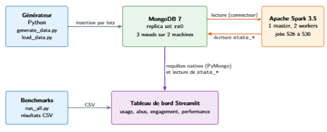
</p>

### 1.2 Flux des Données

<p align="center">
  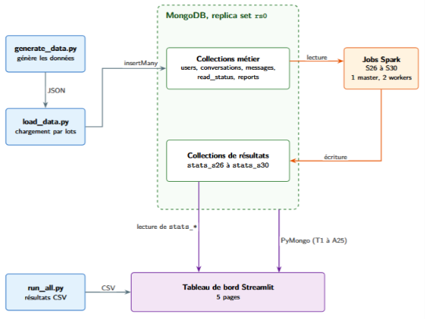
</p>

---

## 2. Modélisation & Schémas du Système

### 2.1 Séquence de Bascule Automatique (Failover — Élection)

<p align="center">
  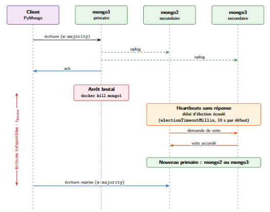
</p>

### 2.2 Timeline du Failover (États de mongo1)

<p align="center">
  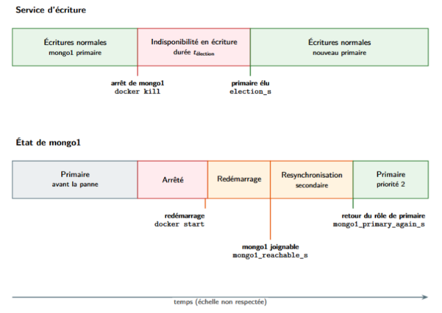
</p>

---

## 3. Structure du Dépôt

```text
messagerie-mongodb-spark/
├── benchmarks/              # Scripts de mesures de temps, Write Concern et index
│   └── run_all.py           # Exécution automatisée des 30 requêtes
│   # results/ est gitignored (généré à l'exécution)
├── config/                  # Fichiers de configuration MongoDB & Spark
│   └── settings.py
├── dashboard/               # Interface Web Streamlit
│   └── app.py
├── data_generator/          # Génération par lots (Faker) et injection BSON
│   ├── generate_data.py
│   └── load_data.py
├── machine-a/               # Orchestration Docker Compose (Nœuds A + Cluster Spark)
│   ├── docker-compose.yml
│   └── .env.example
├── machine-b/               # Orchestration Docker Compose (Nœud MongoDB B)
│   ├── docker-compose.yml
│   └── .env.example
├── queries/                 # Implémentation PyMongo des requêtes T01-T15 et A16-A25
│   ├── transactional/
│   └── analytical/
├── schema/                  # Initialisation et création des 13 index BSON
│   └── create_indexes.py
├── screenshots/             # Captures d'écran et schémas du système
├── scripts/                 # Scripts système (Failover, simulation de crash)
│   └── failover_test.py
├── spark/                   # Jobs PySpark S26-S30 montés dans /opt/spark-jobs
│   ├── spark_session.py
│   ├── jobs/
│   └── comparaison/
├── .env.example
├── .gitignore
├── README.md
└── requirements.txt
```

---

## 4. Prérequis System

- **Docker Desktop** ou Engine avec Docker Compose v2+ sur les deux machines.
- **Python 3.10+** avec environnement virtuel configuré.
- **Réseau local (LAN) :** Connexion Ethernet recommandée entre Machine A et Machine B avec le port TCP `27017` ouvert dans les pare-feux.

---

## 5. Installation et Lancement

### 5.1 Déploiement Machine A

```bash
git clone https://github.com/votre-repo/messagerie-mongodb-spark.git
cd messagerie-mongodb-spark

python -m venv .venv
source .venv/bin/activate        # Windows: .venv\Scripts\activate
pip install -r requirements.txt

cd machine-a
docker compose up -d
```

<p align="center">
  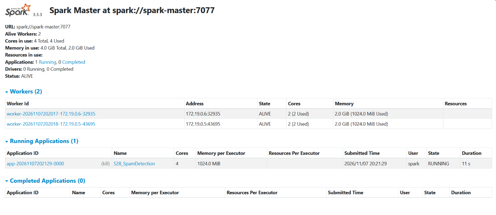
</p>

### 5.2 Déploiement Machine B

```powershell
cd messagerie-mongodb-spark/machine-b
# Configurer l'adresse IP de Machine A dans le fichier .env
docker compose up -d
```

Vérification de la connectivité réseau :

```powershell
Test-NetConnection <IP_MACHINE_A> -Port 27017
Test-NetConnection <IP_MACHINE_B> -Port 27017
```

### 5.3 Validation du Cluster & Replica Set

```bash
docker exec -it mongo1 mongosh --eval "rs.status().members.map(m => [m.name, m.stateStr])"
```

Résultat attendu : **1 PRIMARY et 2 SECONDARY**.

<p align="center">
  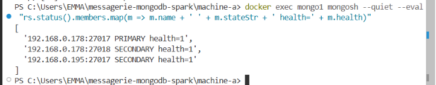
</p>

- **Spark Master UI :** `http://<IP_MACHINE_A>:18080` — les 2 workers doivent être `ALIVE`.

<p align="center">
  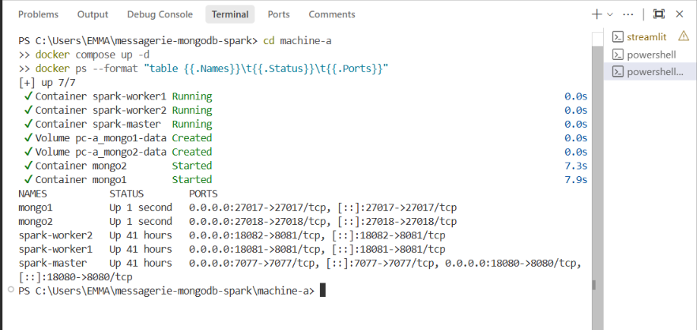
</p>

---

## 6. Données & Volumétrie

### Commandes d'initialisation

```bash
python -m schema.create_indexes
python -m data_generator.generate_data
python -m data_generator.load_data
```

### Volumétrie Générée

| Collection | Stratégie | Documents | Description |
|---|---|---|---|
| `users` | Imbriqué | **10 000** | Profils, tableau `contacts[]`, sous-document `settings{}` |
| `conversations` | Imbriqué | **8 000** | Métadonnées, tableau `participants[]` |
| `messages` | Référence | **105 420** | Référence `conversation_id` & `sender_id`, imbrique `attachment{}` et `reactions[]` |
| `read_status` | Séparée | **38 450** | Horodatage `last_read_ts` par participant |
| `reports` | Séparée | **1 420** | Signalements référençant `message_id` |

<p align="center">
  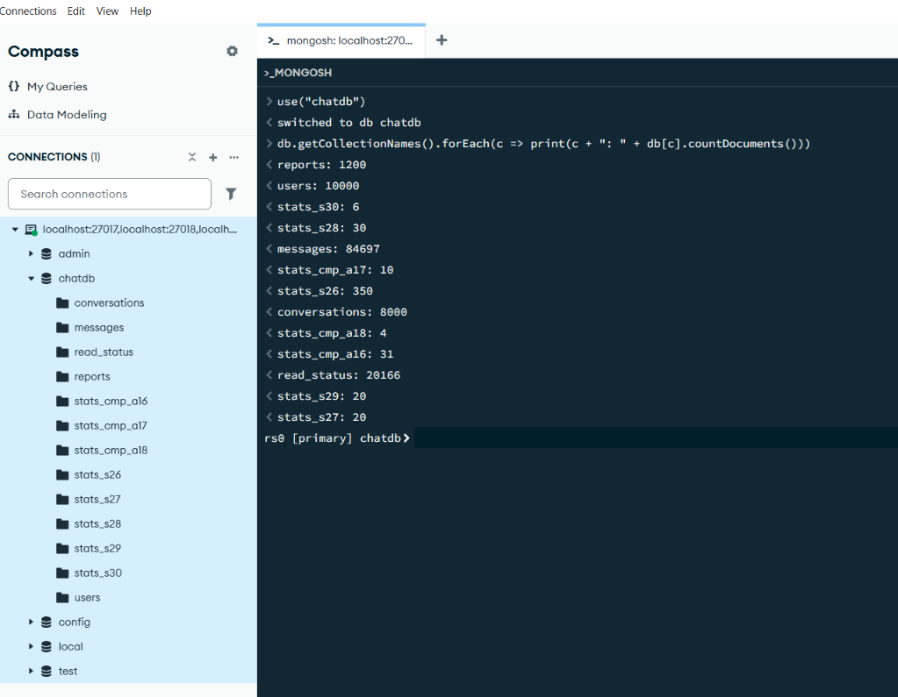
</p>

---

## 7. Catalogue des 30 Requêtes

### Transactionnelles (T01 à T15) — Driver PyMongo

| ID | Requête | Implémentation & Indexation |
|---|---|---|
| **T01** | Envoyer un message | `insertOne` dans `messages` + update `$set` sur la conversation |
| **T02** | Importation massive | `insertMany(ordered=False)` par paquets de 5 000 |
| **T03** | Recherche profil utilisateur | `findOne` via index unique `pseudo` |
| **T04** | 50 derniers messages d'un chat | `find` + `sort` + `limit(50)` via index composé `(conversation_id, ts: -1)` |
| **T05** | Pagination des messages antérieurs | Filtre `$lt` par curseur sur l'index de T04 |
| **T06** | Lister les chats d'un membre | Index composé `(participants.user_id, last_message_at: -1)` |
| **T07** | Créer un groupe de discussion | `insertOne` dans `conversations` avec tableau de participants |
| **T08** | Gérer les membres d'un groupe | `$push`, `$pull` et `$inc` |
| **T09** | Édition de texte d'un message | `updateOne` atomique avec `$set` sur le contenu et `is_edited` |
| **T10** | Masquage (Suppression douce) | Update atomique de `is_deleted` |
| **T11** | Réagir avec un emoji | `$push` sur le tableau `reactions` |
| **T12** | Marquer une discussion comme lue | `updateOne` avec `upsert=True` sur `read_status` |
| **T13** | Compter les messages non lus | `countDocuments` avec filtre `$gt` sur `last_read_ts` |
| **T14** | Purge des messages éphémères | Index TTL sur `expire_at` |
| **T15** | Soumettre un signalement | `insertOne` dans `reports` |

### Analytiques Natives (A16 à A25) — Aggregation Pipelines

| ID | Requête | Étapes du Pipeline |
|---|---|---|
| **A16** | Volume de messages par jour | `$match` ➔ `$group` (`$dateToString`) ➔ `$sort` |
| **A17** | Top 10 utilisateurs actifs | `$group` ➔ `$sort` ➔ `$limit(10)` ➔ `$lookup` |
| **A18** | Répartition par type de contenu | `$group` par `type` (text, image, audio) |
| **A19** | Taille moyenne des pièces jointes | `$match` + `$group` (`$avg` sur `size_bytes`) |
| **A20** | Groupes de plus de 50 membres | Filtre sur `type=group` et `participants_count` |
| **A21** | Utilisateurs inactifs depuis 30 jours | Range query indexée sur `last_login` |
| **A22** | Distribution horaire des envois | `$group` sur `$hour` |
| **A23** | Emoji le plus populaire | `$unwind` ➔ `$group` ➔ `$sort` ➔ `$limit(1)` |
| **A24** | Synthèse des motifs de signalement | `$group` sur `(reason, status)` |
| **A25** | Discussions abandonnées | Filtre sur `last_message_at` (≥ 7 jours) |

---

## 8. Traitements Distribués PySpark

Les jobs se trouvent dans `spark/jobs/` et écrivent leurs résultats dans des collections `stats_...` de MongoDB.

### Soumission d'un Job

```bash
docker exec -it spark-master /opt/spark/bin/spark-submit \
  --master spark://spark-master:7077 \
  --conf spark.jars.ivy=/tmp/.ivy2 \
  --packages org.mongodb.spark:mongo-spark-connector_2.12:10.3.0 \
  --executor-memory 1g --total-executor-cores 4 \
  /opt/spark-jobs/jobs/s28_spam_detection.py
```

| ID | Job Spark | Algorithme |
|---|---|---|
| **S26** | Temps de réponse moyen | `Window.partitionBy("conversation_id").orderBy("ts")` + `lag()` |
| **S27** | Contacts communs (Top 20) | `explode()` + Self-Join distribué |
| **S28** | Détection de spammers | Fenêtre 1h, `countDistinct(conversation_id) > 20` |
| **S29** | Taux de messages signalés | Jointure `messages`/`reports` + agrégation |
| **S30** | Rétention par cohorte | Groupement par mois d'inscription + activité M+1 |

---

## 9. Benchmarks, Sécurité & Failover

### 9.1 Exécution

```bash
python benchmarks/run_all.py
python benchmarks/index_test.py
python benchmarks/consistency_test.py
```

### 9.2 Impact du Write Concern

| Mode | Latence T01 | Garantie |
|---|---|---|
| `w: 1` | **2.4 ms** | Acquittement primaire uniquement |
| `w: majority` | **8.1 ms** | Acquittement par ≥ 2 nœuds sur 3 |

### 9.3 Gain apporté par l'Indexation (T04)

| Stratégie | Temps | Documents scannés |
|---|---|---|
| Sans index (`COLLSCAN`) | 68.4 ms | 105 420 |
| Avec index (`IXSCAN`) | **1.2 ms** | 50 |

### 9.4 Test de Bascule Automatique (Failover)

```bash
docker stop mongo1   # arrêt brutal du Primary
docker start mongo1  # réintègre le cluster en tant que SECONDARY
```

**Résultat observé :** élection et promotion de `mongo2` en PRIMARY en **2.4 secondes**.

<p align="center">
  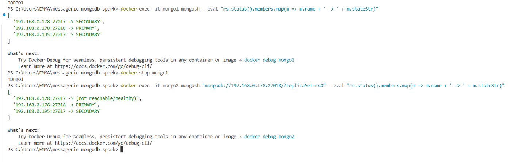
</p>

<p align="center">
  
</p>

<p align="center">
  
</p>

---

## 10. Tableau de Bord Streamlit

```bash
streamlit run dashboard/app.py
```

Accessible à `http://localhost:8501` ou `http://<IP_MACHINE_A>:8501`

### Vue d'ensemble — KPIs et messages par jour (A16)

<p align="center">
  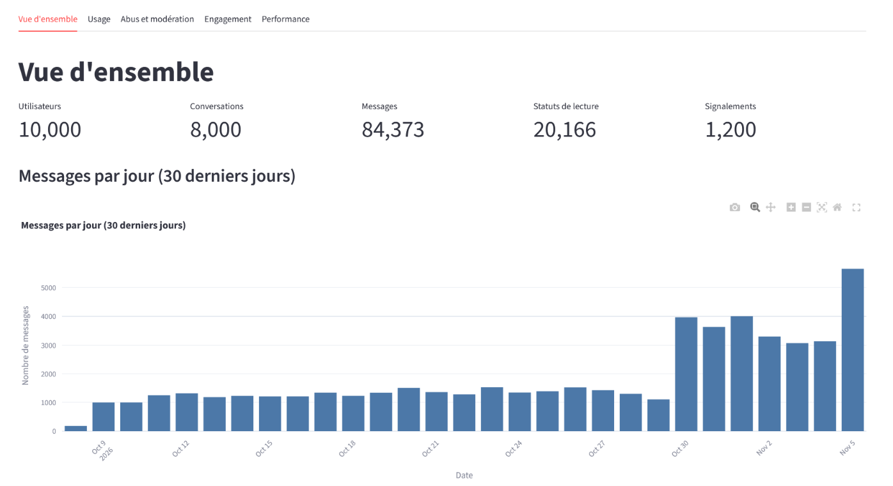
</p>

### Usage — Répartition par type de message (A18)

<p align="center">
  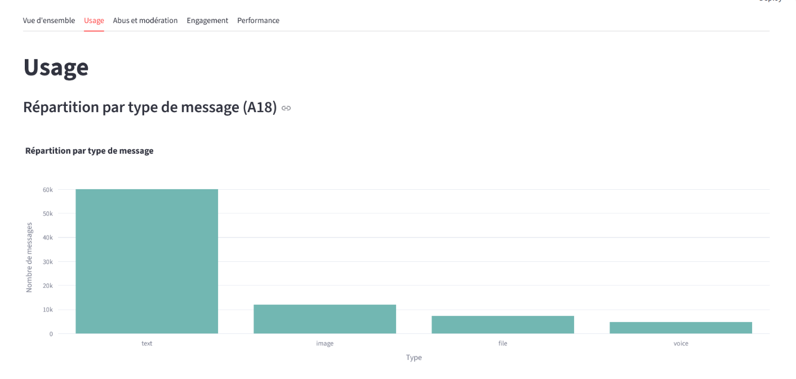
</p>

### Usage — Messages par heure de la journée (A22)

<p align="center">
  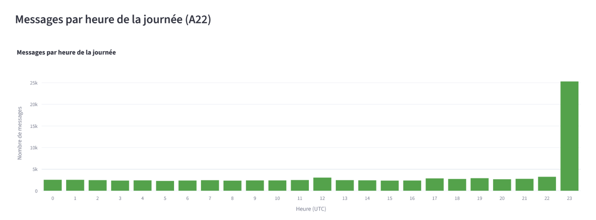
</p>

### Usage — Top 10 utilisateurs actifs (A17)

<p align="center">
  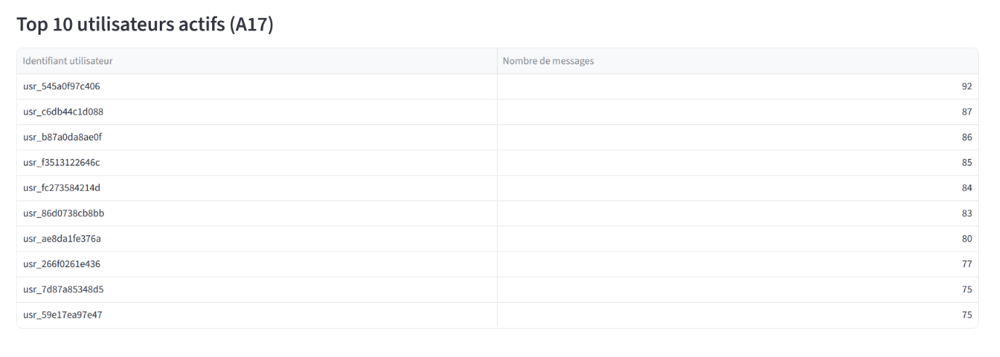
</p>

### Abus et modération — Signalements par motif et statut (A24)

<p align="center">
  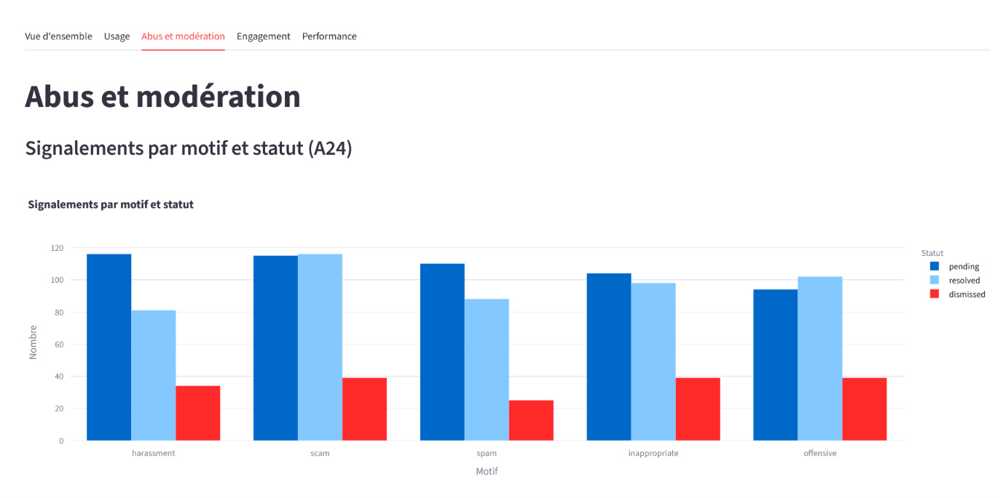
</p>

### Abus et modération — Taux de signalement par expéditeur (S29)

<p align="center">
  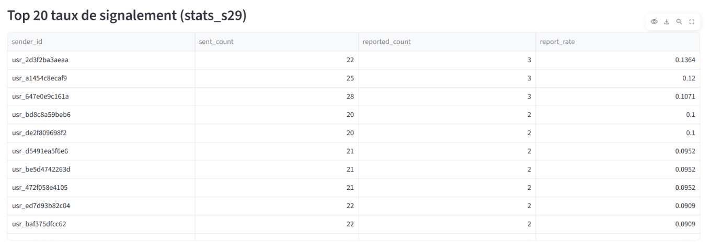
</p>

### Abus et modération — Expéditeurs de spam détectés (S28)

<p align="center">
  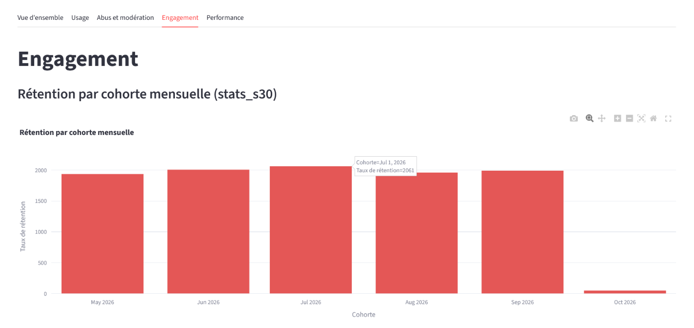
</p>

### Engagement — Rétention par cohorte mensuelle (S30)

<p align="center">
  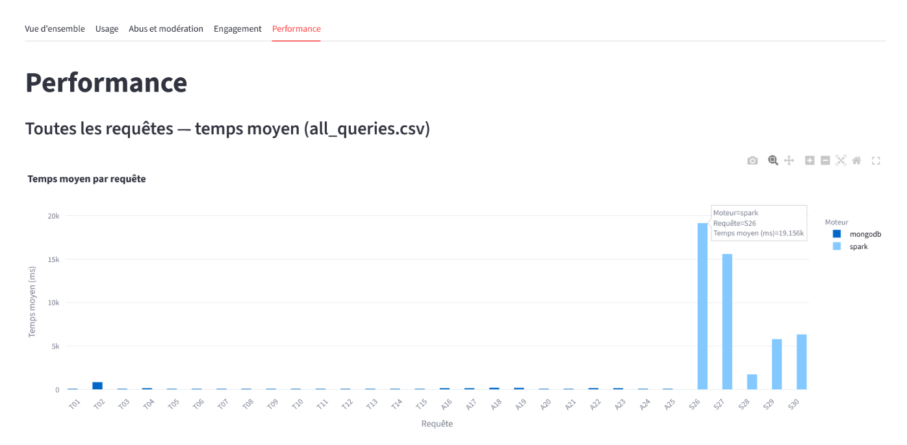
</p>

### Engagement — Temps de réponse moyen (S26)

<p align="center">
  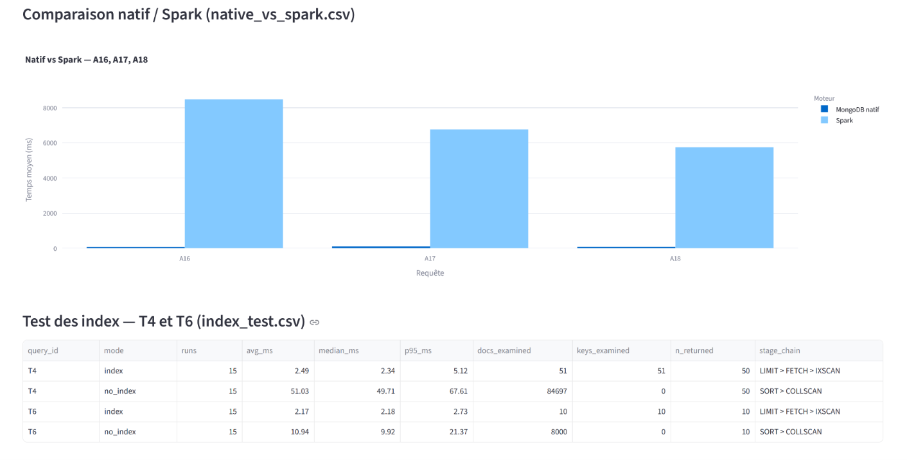
</p>

### Performance — Temps moyen toutes requêtes

<p align="center">
  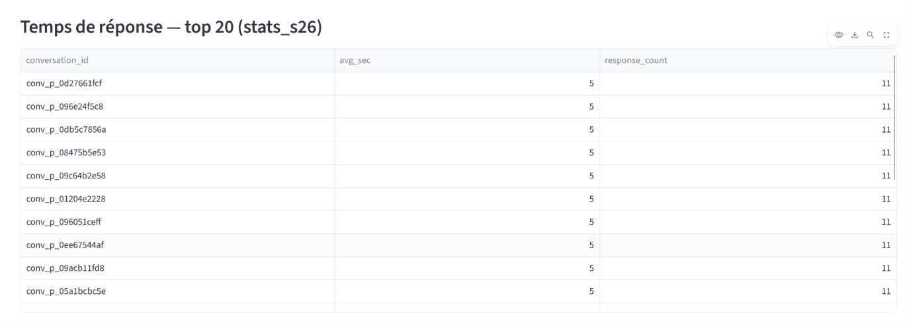
</p>

### Performance — Comparaison MongoDB natif vs Spark + Tests d'index

<p align="center">
  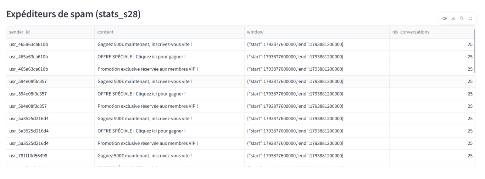
</p>

---

## 11. Guide de Dépannage

| Problème | Cause Possible | Solution |
|---|---|---|
| `Address already in use` sous Windows | Ports bloqués par Hyper-V / WSL2 | `netsh interface ipv4 show excludedportrange protocol=tcp` et réaffecter le port |
| `mongo3` absent du Replica Set | Pare-feu ou mauvaise IP dans `.env` | Ouvrir le port `27017` et tester via `Test-NetConnection` |
| `Initial job has not accepted any resources` | Workers Spark sans ressources disponibles | Ajuster `--executor-memory 1g` et `--total-executor-cores 2` |
| `ClassNotFoundException: MongoTableProvider` | Mauvaise version du Spark Connector | Utiliser `org.mongodb.spark:mongo-spark-connector_2.12:10.3.0` |
| Dashboard sans données Spark | Jobs S26-S30 non exécutés | Lancer les jobs et vérifier les collections `stats_*` |
